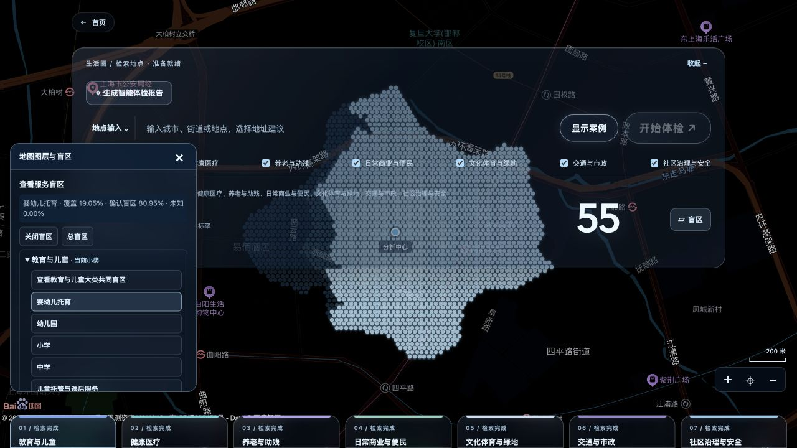
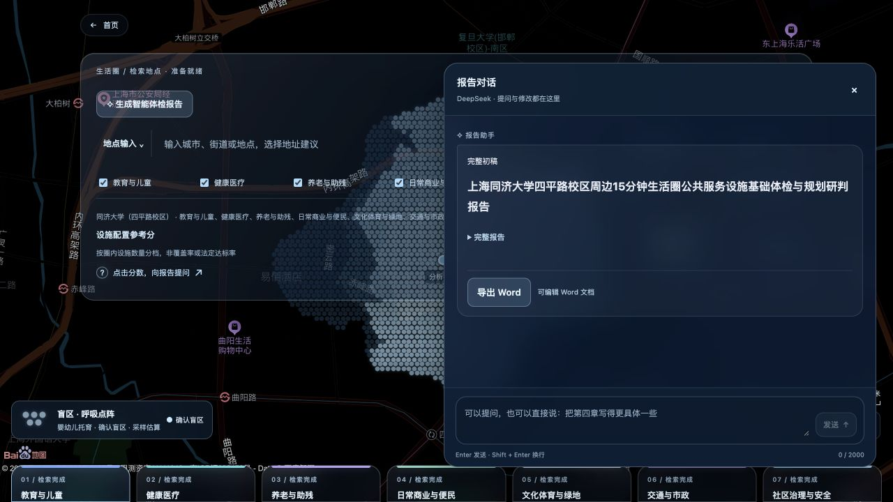

# 步衡 WalkScope | 作品介绍

第四届开放原子大赛 · 2026 开源行业解决方案创新赛 / 参赛材料

步衡 WalkScope

## 步衡 WalkScope

15分钟生活圈公共服务设施
体检与规划研判平台

把设施点位、步行服务范围与报告表达接在一起，为规划前期排查提供可追溯的线索。

| 参赛信息 | 内容 |
| --- | --- |
| 队伍 | 野蛮人鲈鱼豪 |
| 参赛人 | 刘彦和、于明睿 |
| 拟投方向 | 赛道一：开源基础软件与解决方案 / 行业应用平台与数据平台 |
| 演示案例 | 上海同济大学四平路校区周边 |
作品摘要

平台面向自然资源和规划主管部门相关业务处室，以及开展城市更新和公共服务设施研究的团队。用户指定中心点后，可查看七组设施检索、步行范围、各小类服务缺口，并在同一对话中提问、修改报告文字、导出可编辑 Word。

当前成果为可本地运行的研究原型，提供完整代码、保存案例、测试与说明文档。案例包含7大类、45小项，设施配置参考分55。分值按圈内设施数量分档，不能直接解释为覆盖率或法定达标率。

本文记录截至2026年10月29日的实际功能与验证情况。视频、报名及正式提交按后续流程完成。

01  从“有多少”走向“服务到哪里”

## 01  从“有多少”走向“服务到哪里”

前期调研常需要在地图检索、步行判断和报告编写之间反复切换。仅统计设施点位，难以说明生活圈内哪些位置仍缺少服务；仅展示一张图，又难以把证据整理为后续核查任务。

01  选择分析地点

以指定中心点生成步行生活圈，选择教育与儿童、健康医疗等七组设施。分析对象是该中心周边步行圈，边界不等同于行政社区。

02  读取设施与服务范围

区分圈内设施和圈外覆盖候选，查看设施点位、路线及服务区。按大类或小类检查服务盲区，避免用父级结果替代小类测算。

03  整理调研结论

围绕保存结果提问，形成设施现状、缺口、规划调研建议和局限说明；需要修改时直接输入自然语言指令。

04  导出可编辑成果

每份报告卡片下提供 Word 导出。默认初稿完整；本页可连续修改，刷新后恢复完整初稿，便于反复演示和比较。

应用场景

用于详细规划、城市更新及公共服务设施布局研究的前期排查：先发现需要核对的设施与片区，再组织现场调查、台账核实和人口需求分析。当前没有宣称替代部门审查或自动给出建设选址。

02  地图证据与计算口径

## 02  地图证据与计算口径

图1  真实产品截图：托育小类覆盖19.05%，确认盲区80.95%，未知显示0.00%。

空间计算采用真实 POI 起点和实际步行测距，构建1000米步行等距线服务区；边界通过测距采样插值估算。中心15分钟步行圈采用100米采样，20米网格用于覆盖分析辅助，不作为最终折线边界。

七大类共同盲区表示该大类的任意小项均未提供服务的部分；小类盲区只读取该小类保存几何。大类有服务，不代表每种设施齐全。

当前45小项未知比例均小于1e-8，界面四舍五入为0.00%。这只说明本轮采样估算的区域已得到分类，不代表完成现场核验，也不表示未来任何地点都不会出现未知区域。

盲区和未核验区域按展示要求统一使用浅蓝色，数据仍保留两者的不同语义；未知不能被当作已确认缺失。

03  一处对话，完成提问、修改与导出

## 03  一处对话，完成提问、修改与导出

图2  真实产品截图：完整初稿、统一输入框及报告卡片下的 Word 导出。

报告通道把已保存的测算事实与可编辑文字分开。参考分、设施数量、覆盖比例及原始几何由计算结果提供；模型用于解释和改写第三至第五章的研判文字，不能任意改动测算事实。

例如输入“把第三章去掉”，本页报告和导出的 Word 会同步去掉该章；刷新后重新打开报告，第三章恢复。另一次真实 DeepSeek 联调已验证“强化养老与助残专项调研”的段落改写，事实数据保持不变。

无模型密钥时仍可使用保存事实稿和 Word 导出；需要模型改写而模型不可用时会明确提示。精确删章等本地操作可独立完成。

当前报告编辑面向章节正文与删章，不包含任意 Word 版式编辑。模型服务为外部 DeepSeek API，本项目不附带模型权重。

04  已完成成果与持续建设

## 04  已完成成果与持续建设

| 维度 | 当前可验证成果 |
| --- | --- |
| 场景完整性 | 七组45小项；保存案例回放；设施点、路线、大小类盲区；报告对话与 Word |
| 工程验证 | 本机与GitHub Ubuntu全新环境通过；后端825项、前端236项；3项在线百度测试跳过；类型检查和构建通过 |
| 开源准备 | 保留原 MIT 署名；整理运行说明、贡献指南、安全说明、数据来源与 CI 定义 |
| 可追溯性 | 原始报告与草稿隔离；初稿、页面修改和卡片快照分别保存；关键样例有文件摘要 |
当前价值

作品把地图计算与可编辑报告串成可重复验证的操作流程；大小类结果独立解释，避免颜色和分数替代证据；模型改写受到事实约束，便于在报告中继续安排核查任务。这些是本项目的实现特点，尚未进行同类产品的量化优劣对比。

后续路线

近期：补齐演示视频与仓库可访问链接，完成报名和提交。后续拟加入设施开放条件、容量与人口需求核查，扩大案例验证，并完善多人权限、持久化和部署监控。以上属于计划，当前未宣称已上线。

材料与参考

提交包提供作品介绍、技术设计、验收说明、源码和完整初稿 Word。目录组织参考 linzhi 仓库的文档、样例及开源治理分工，未复制其功能或技术成果。

赛事指南：https://www.oschina.net/oa2026/
目录参考：https://github.com/kaiccck/linzhi
代码许可：MIT（原署名保留）；地图与接口数据的权利不因代码许可而转移。
