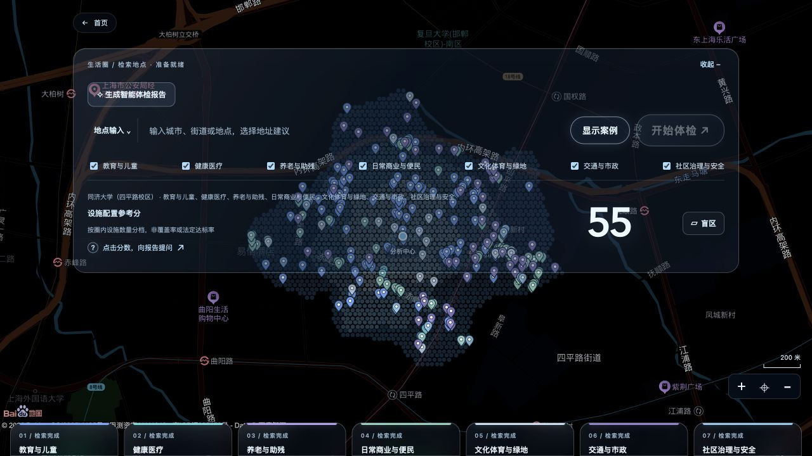

# 步衡 WalkScope | 验收说明

01  案例与指标核对

## 01  案例与指标核对

主案例为同济大学四平路校区周边保存报告，包含7大类45小项，设施配置参考分55。地图、报告和Word采用同一保存事实进行核对。

| 小类 | 覆盖 | 确认盲区 | 未知 |
| --- | --- | --- | --- |
| 小学 | 99.81% | 0.19% | 0.00% |
| 药店 | 96.67% | 3.33% | 0.00% |
| 菜市场 | 93.60% | 6.40% | 0.00% |
| 婴幼儿托育 | 19.05% | 80.95% | 0.00% |
覆盖比例来自保存的采样插值估算结果，数量参考分按圈内数量分档。设施开放条件、容量及人口需求需结合进一步调查判断。

同济案例地图总览与七组设施卡片。

02  自动化与联调验证

## 02  自动化与联调验证

| 检查项 | 结果 |
| --- | --- |
| 后端回归 | 825项通过，3项需显式启用并配置AK的在线百度测试跳过；6项既有Shapely弃用警告 |
| 前端回归 | 236项通过，覆盖页面身份、修改、导出和旧快照等交互契约 |
| 类型与构建 | vue-tsc类型检查及Vite生产构建通过 |
| Ubuntu新环境 | 依赖安装、52项样例还原、后端和前端测试、生产构建、离线自检通过 |
| 真实模型改写 | 养老与助残专项调研正文完成改写，锁定事实保持一致，Word与新稿相符 |
| 页面与API | 指令删第三章、导出同步、刷新恢复、非法页面ID拒绝及来源一致性检查通过 |
复核方式

后端执行python -m pytest -q，前端执行npm test与npm run build；python tools/verify_handoff.py核验保存案例、完整初稿、Word导出及任务终态。真实模型证据、页面核对记录和测试日志随材料提供。

测试覆盖的意义

回归检查核对代码契约与操作结果，包括保存数据不被报告编辑改写、同一页面的连续修改、卡片快照对应导出、刷新后的初稿恢复及固定样例重放。空间分类准确率、设施容量与现场可用性需要另行开展专项核查。

远程运行

github.com/doewkhem55-art/walkscope/actions/runs/40885221081

03  操作验收与成果检查

## 03  操作验收与成果检查

| 操作 | 预期结果 |
| --- | --- |
| 载入同济保存案例 | 7大类45小项，参考分55；直接回放保存结果 |
| 选择婴幼儿托育 | 显示自身几何，覆盖19.05%、盲区80.95%，浅蓝高亮 |
| 打开报告对话 | 默认完整初稿包含第三章；一个输入框；每份报告下提供Word导出 |
| 输入“把第三章去掉” | 本页报告及对应Word同步删除第三章 |
| 关闭再打开 | 保留本页修改 |
| 刷新后重新打开 | 恢复完整初稿与第三章，界面和Word不显示内部编号 |
| 提出文字改写要求 | 有效模型配置下更新允许章节，锁定数值与附表保持一致 |
交付成果核对

源码、作品介绍、技术设计、验收说明、保存案例、完整初稿Word、产品截图及运行日志均已整理。文件摘要用于检查材料是否完整，样例摘要用于检查还原数据是否与原始输入一致。

提交事项

报名、负责人信息、评委仓库访问权限及演示视频在提交清单中单独维护，便于根据报名确认要求逐项完成。
